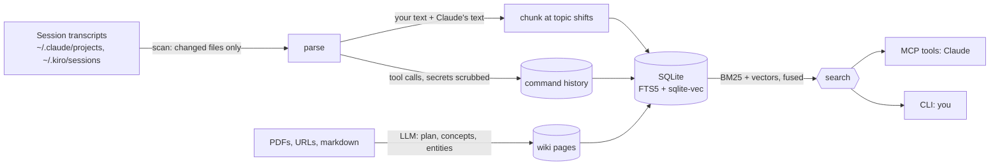

# medulla

A living journal of everything you've done with Claude Code: every session indexed, searchable, and
ready to pick back up.

[](LICENSE)
[](https://github.com/aarushgarg1110/medulla/actions/workflows/ci.yml)
[](.github/workflows/ci.yml)
[](pyproject.toml)
[](#install)

<!-- demo GIF: autohandoff opening the next part (coming) -->

Claude Code starts every session blank, yet your transcripts already record every decision, command and
dead end you've worked through, in files nothing ever reads. medulla is dual-layer memory for Claude Code
and Kiro: it indexes every session into a searchable journal, and turns the papers and pages you give it
into a linked wiki, all in one local SQLite file. Ask what you decided last month, find the command you
ran, or carry one piece of work across as many sessions as it needs.

<p align="center">
  <a href="#install">Install</a> •
  <a href="#quickstart">Quickstart</a> •
  <a href="#use-cases">Use cases</a> •
  <a href="#how-it-works">How it works</a> •
  <a href="#handoff-and-pickoff">Handoff and pickoff</a> •
  <a href="#autohandoff">Autohandoff</a> •
  <a href="#commands-and-tools">Commands and tools</a> •
  <a href="#faq">FAQ</a>
</p>

## Highlights

- **A journal that writes itself.** Every session, subagent and command is indexed as you work, with no
  size cap and no notes to keep.
- **Ask your past.** "Where did we decide X?" or "the query I ran for Y" finds the exact passage, whether
  you wrote it or Claude did.
- **Pick up where you left off.** A structured handoff ends one session; a single call starts the next
  one from it.
- **Never hit the wall.** [Autohandoff](#autohandoff) writes the handoff near the end of the context
  window and opens the next part beside you.
- **A wiki that compounds.** Papers and pages become linked concept pages that grow as you add more.
- **Local.** One SQLite file, embeddings computed on your machine, nothing to deploy.

## Install

medulla runs on [uv](https://docs.astral.sh/uv/), which also fetches Python 3.12 for it:

```bash
# On macOS and Linux.
curl -LsSf https://astral.sh/uv/install.sh | sh
```

### Claude Code (recommended)

Install the CLI and index your history:

```bash
uv tool install git+https://github.com/aarushgarg1110/medulla
medulla scan
```

Then add the plugin:

```bash
claude plugin marketplace add aarushgarg1110/medulla
claude plugin install medulla@medulla
```

The plugin is what Claude uses: the MCP server, the handoff and pickoff skills, and autohandoff. The CLI
comes first because it indexes the history you already have, and because it caches the plugin's
dependencies (about 844 MB), so the plugin's first start takes seconds instead of outlasting Claude
Code's server start. Your next Claude Code session has medulla.

### Kiro, or Claude Code without the plugin

The same CLI also runs as a plain MCP server. You get search and resume, without the skills or
autohandoff:

```bash
uv tool install git+https://github.com/aarushgarg1110/medulla
medulla scan
claude mcp add medulla medulla -- mcp     # Claude Code
```

For Kiro, add the server to its MCP config:

```json
{ "mcpServers": { "medulla": { "command": "medulla", "args": ["mcp"] } } }
```

Use the plugin or `claude mcp add`, not both, or Claude Code runs two medulla servers.

### A pre-release

Pin the tag in both commands. Without a GitHub SSH key, set `CLAUDE_CODE_PLUGIN_PREFER_HTTPS=1` first.

```bash
uv tool install git+https://github.com/aarushgarg1110/medulla@v0.2.0-rc1
claude plugin marketplace add aarushgarg1110/medulla#v0.2.0-rc1
```

## Quickstart

Ask about anything you've done before, in any session:

> Use medulla to find where we decided on the retry policy, and why.

To carry a piece of work across sessions, give it a name (start with `claude -n foo`, or run
`/rename foo`), then:

```text
/medulla:handoff              the session's last message: a report the next one starts from
/medulla:pickoff fooPart2     the next session's first: read it, check it, restate, wait for you
```

To stop thinking about the context window at all, turn on autohandoff: open `/config` and set
**autohandoff** to on.

## Use cases

| You ask | What medulla does |
|---|---|
| "What did we decide about the cache, and why?" | Searches everything you and Claude wrote, in every project, with recent sessions weighted a little higher |
| "Find the duckdb query I used to compare the two runs." | Searches the command history: every command Claude ran, with secrets scrubbed |
| "Pick up fooPart3." | Returns fooPart3's handoff report and its sibling parts in one call; Claude checks it and restates |
| "What have I been doing in this repo lately?" | Lists the project's recent sessions and the commands run in them |
| "Ingest this paper, then explain section 3 against what we tried last month." | Writes wiki pages for the paper, then searches the wiki and your sessions together |

## How it works



### Indexing the journal

- **Incremental.** A scan re-reads only the transcripts whose modification time changed. Subagent
  transcripts are linked to the session that launched them.
- **Both sides of the conversation.** Your messages and Claude's are indexed, since Claude's analysis
  and findings are usually what you want to find again. Tool calls stay out of the chunks: they are stored
  separately as a command history, with literal secrets (inline passwords, AWS keys, bearer tokens)
  redacted first.
- **Chunked by topic, not by count.** A chunk grows toward about 2,500 characters and never passes 4,000,
  and it ends early where the conversation changes subject, judged by how much the vocabulary of
  neighbouring turns overlaps. An abrupt change cuts at once; a gradual drift has to persist before it
  cuts, so a session is never shredded into fragments.

### Searching it

- **Hybrid ranking.** Every query runs twice, once as keywords (SQLite FTS5, BM25) and once as meaning
  (cosine similarity over local e5-base-v2 embeddings in sqlite-vec). The two rankings are combined with
  reciprocal rank fusion, plus a small boost for recent sessions (30-day half-life). Matching commands are
  added as a capped supplement, so they never crowd out the conversation.
- **Never silently stale.** Search tells you when transcripts have changed since the last index, and can
  refresh first. Resume indexes the session it resumes on the spot, because a session that just ended
  wrote its handoff after its last index.
- **Degrades gracefully.** Without embeddings, search falls back to keywords alone.

### Building the wiki

An ingest plans first (a source page, plus the concepts and entities it introduces), then writes one page
per concept and entity. The names of existing pages go into the prompt, so links point at pages that
exist and a shared concept is updated instead of duplicated. Related pages are linked by embedding
similarity, and sources are deduplicated by URL or content hash.

```bash
medulla use bedrock                            # or anthropic, or ollama for a fully local LLM
medulla ingest ~/Downloads/Adam-Optimizer.pdf  # a source page, its concepts and entities
medulla ingest https://karpathy.github.io/2026/02/12/microgpt/   # updates the concepts both share
medulla wiki open                              # browse it in Obsidian
```

## Handoff and pickoff

Parts of one piece of work share a name stem (foo, fooPart2, fooPart3), so each part can find the
others.

**Handoff** (`/medulla:handoff`) ends a session with a report written for the next task rather than as
a summary:
- the goal, and what was done, with commit hashes and run ids
- open items, including decisions still owed
- the one next action
- a lookup table of the paths, ids and numbers that would be painful to find again
- keywords and suggested reading for the next session

It searches its own transcript before writing, because in a long session the early turns have left the
context window. You can give it a focus (`/medulla:handoff focus on the backtest`); `nonext` skips
opening the next part.

**Pickoff** (`/medulla:pickoff fooPart2`) starts the next session with one call. It reads the report,
follows its pointers, checks them against git and the files it names, restates the plan, and **waits for
your correction before doing any work**. Without a name, it takes the most recent session in the project
and tells you which one it chose.

# Autohandoff

**The session ends; the work doesn't.** Near the end of the context window, medulla asks Claude to write
the handoff, then opens the next part beside the current one, already picking it up:

```bash
claude -n fooPart4 '/medulla:pickoff fooPart3 opened automatically: restate, then wait for my reply before doing any work'
```

It is off by default. Turn it on in `/config`, where each medulla option is a row, or when installing:

```bash
claude plugin install medulla@medulla --config autohandoff=true
```

| Option | Default | Environment override |
|---|---|---|
| autohandoff | off | `MEDULLA_AUTOHANDOFF` |
| autohandoff_at | 93% of the window (50–99) | `MEDULLA_AUTOHANDOFF_AT` (no floor) |
| context_window | detected | `MEDULLA_CONTEXT_WINDOW` |
| terminal | detected | `MEDULLA_TERMINAL`: tmux, ghostty, iterm, terminal or print |

| Your terminal | The next part opens as |
|---|---|
| tmux, any OS | a split of the current pane; works with the laptop lid closed |
| Ghostty 1.3+ | a split of the current pane, through Ghostty's own scripting; no Accessibility permission |
| iTerm2 | a split of the current session |
| Terminal.app | a new window |
| anything else | a printed command for you to run |

**Good to know**
- **Set options in /config, not the environment.** The next part starts in a new pane, which inherits
  neither the variables on your command line nor a `--plugin-dir`.
- **The environment threshold has no floor.** It exists for testing: set below a fresh session's starting
  context, every part hands off on its first turn.
- **macOS terminals need an awake display.** With the lid closed, use tmux. If the Mac sleeps while a part
  is opening, your next prompt in that session tells you; `medulla nextpart` opens it by hand.
- **The window size** is reported only to the statusline. `/medulla:statusline` adds a context bar that
  records it, or wraps the statusline you have without changing its output. Without it, medulla uses the
  configured size, then a `[1m]` model in your settings, then 200k, and switches to 1M once the context
  passes 200k tokens.

## Commands and tools

The CLI is for you; the MCP tools are what Claude calls. Most capabilities have both.

| What | CLI | MCP tool |
|---|---|---|
| Index new and changed sessions | `medulla scan [--force] [--source claude\|kiro]` | `medulla_search` with `refresh`; `medulla_resume` indexes its session |
| Search sessions, wiki and commands | `medulla search "<query>" [--layer episodic\|semantic\|events] [--bm25-only] [-n N]` | `medulla_search` |
| Read the top hits in full | `medulla search "<query>" --expand N` | `medulla_search` with `expand` |
| Resume a session | `medulla resume <name>` | `medulla_resume` |
| Open the next part by hand | `medulla nextpart [--from <title>] [--dry-run]` | |
| Recent sessions | `medulla list [--project <path>]` | `medulla_list` |
| A session's chunks, agents and files | `medulla session-detail <id> [--chunk N]` | `medulla_session_detail` |
| A session and its subagents | | `medulla_session_tree` |
| Recent work in a project | | `medulla_project_context` |
| Search the command history | `medulla search "<query>" --layer events` | `medulla_events_search` |
| Statistics | `medulla stats`, `medulla status` | `medulla_stats` |
| Ingest into the wiki | `medulla ingest [<file\|url>] [--force]` | `medulla_ingest` (a page Claude wrote), `medulla_ingest_url` |
| Wiki pages and links | `medulla wiki list\|open\|lint` | `medulla_wiki_schema`, `medulla_wiki_search`, `medulla_wiki_page` |
| Pending sources | `medulla status` | `medulla_list_raw` |
| Remove a wiki page or raw file | `medulla remove <type/slug\|raw/file> [--cascade]` | `medulla_remove` |
| Embeddings and related links | `medulla embed [--force] [--reindex-edges]` | `medulla_reindex_edges` |
| Wiki LLM provider | `medulla use bedrock\|anthropic\|ollama [--model <id>]` | |
| Statusline | `medulla statusline setup\|undo` | the `/medulla:statusline` skill |
| Search quality (NDCG@k, MRR) | `medulla eval`, `medulla eval-gen` | |
| Start over | `medulla reset [--all] [-y]` | |
| Run the MCP server | `medulla mcp` | |

## Configuration

Everything lives in `~/.medulla/`. Set `MEDULLA_DIR` to use another directory, such as one for testing.

```
~/.medulla/
├── medulla.db        sessions, commands, wiki pages, and their FTS5 + vector indexes
├── config.toml       the wiki's LLM provider and model
├── state/            autohandoff and statusline state, including autohandoff.log.jsonl
└── wiki/             an Obsidian vault: index.md, log.md, raw/, sources/, concepts/, entities/
```

The wiki's LLM provider is Bedrock by default (through an AWS cross-region inference profile):

```bash
medulla use anthropic     # needs ANTHROPIC_API_KEY
medulla use ollama        # fully local
medulla status            # check the provider and model
```

Behind a corporate proxy (Zscaler and similar), point Python at your CA bundle in `~/.zshenv` rather
than `~/.zshrc`, so every subprocess sees it:

```bash
export SSL_CERT_FILE=/path/to/ca-bundle.pem
export REQUESTS_CA_BUNDLE=/path/to/ca-bundle.pem
```

## FAQ

<details>
<summary><b>How is this different from RAG, a vector database, or other session indexers?</b></summary>

RAG and vector stores retrieve documents but rediscover knowledge from scratch on every query: nothing
accumulates, and nothing is synthesized. Graph databases are powerful but need schema design and
infrastructure. Some session indexers cap how much of a session they keep, so anything after the first
few dozen messages is invisible. medulla indexes whole sessions with no cap, keeps a wiki that compounds
as you add sources, and runs as one local file with nothing to deploy.
</details>

<details>
<summary><b>Does anything leave my machine?</b></summary>

Indexing and search are local, and embeddings are computed locally (the embedding model is downloaded
once). Only wiki ingestion calls an LLM, the provider you choose; with Ollama that is local too.
</details>

<details>
<summary><b>What about secrets in my sessions?</b></summary>

Commands and their output are scrubbed of literal secrets (inline passwords, AWS keys, bearer tokens)
before they are stored. Conversation text is stored as written, in your local database only.
</details>

<details>
<summary><b>Does it work with Kiro?</b></summary>

Kiro sessions are indexed, and the MCP server works in Kiro. The handoff and pickoff skills are written in
the portable Agent Skills format. Autohandoff relies on Claude Code hooks, so it is Claude Code only for now.
</details>

<details>
<summary><b>The plugin's MCP server didn't connect on its first start.</b></summary>

Its first start installs a large set of dependencies. Install the CLI (see [Install](#install)), which
caches them, then restart Claude Code.
</details>

<details>
<summary><b>Autohandoff didn't open the next part.</b></summary>

Read the message after the report, then `~/.medulla/state/autohandoff.log.jsonl`, which records each
request, attempt and result. `medulla nextpart` opens the next part by hand. A session without a name
cannot be handed off: name it with `/rename`.
</details>

<details>
<summary><b>The handoff fired far too early.</b></summary>

The nudge says where the threshold came from: the environment, `/config`, or the default. A variable
left over from testing is the usual cause.
</details>

## Development

```bash
git clone https://github.com/aarushgarg1110/medulla && cd medulla
uv sync --dev
uv run pytest --cov=medulla --cov-branch         # CI fails below 95% statement coverage
claude --plugin-dir .                            # try the plugin from your checkout
MEDULLA_DIR=~/.medulla-dev uv run medulla scan   # never test against your real ~/.medulla
```

`main` is always green. Work happens in GitHub issues and feature branches, merged after CI and review.
The roadmap lives in the [issues](https://github.com/aarushgarg1110/medulla/issues).

Built with Python 3.12 and uv, Typer and Rich, SQLite with FTS5 and sqlite-vec, sentence-transformers,
the official MCP SDK, PyMuPDF, httpx and trafilatura.

## Acknowledgements

- **[Andrej Karpathy](https://x.com/karpathy/status/2039805659525644595)**, for the LLM wiki pattern:
  source, concept and entity pages that an LLM maintains and that accumulate over time.
- **[kcp-memory](https://github.com/Cantara/kcp-memory)** (Cantara), for the episodic indexing
  architecture: SQLite schema, JSONL parsing, FTS5 and incremental scanning.
- **[OpenKB](https://github.com/VectifyAI/OpenKB)** (VectifyAI), for the planning step, schema injection
  for accurate wikilinks, and ghost-link detection.

## License

[MIT](LICENSE)
